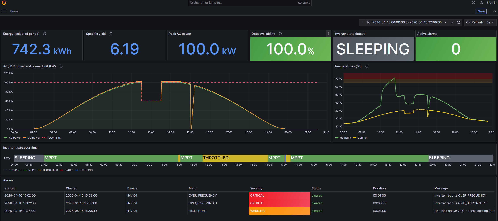
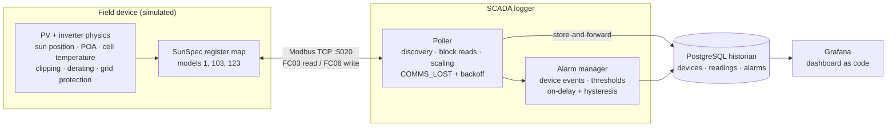

# PV Inverter Simulator + SCADA Data Logger

**A complete, runnable mini-SCADA for a 100 kW photovoltaic plant** — a physics-based SunSpec inverter
simulator talking Modbus TCP to a data logger with a PostgreSQL historian, an alarm manager and a
Grafana control-room dashboard. One command starts everything.

`Python` · `Modbus TCP` · `SunSpec` · `PostgreSQL` · `SQL window functions` · `Docker Compose` · `Grafana` · `pytest`



*A simulated day (16 April, Athens): clipping at 100 kW, a cooling-fan failure (HIGH_TEMP warning),
grid-operator curtailment to 60 % (dashed limit line) and an over-frequency grid trip followed by a
reconnect delay and power ramp — all produced by the simulator, detected by the logger and stored in the historian.*

---

## Quick start

Requires only [Docker Desktop](https://www.docker.com/products/docker-desktop/).

```bash
git clone https://github.com/stplato/inverter-modbus-logger.git
cd inverter-modbus-logger
docker compose up -d --build
```

Open **http://localhost:3000** — the dashboard fills up live (one simulated hour per real minute).

Make things happen (from a Python 3.12+ venv with `pip install -r requirements.txt`):

```bash
python -m logger.set_limit 60              # grid operator curtails the plant to 60 %
python -m logger.set_limit off
python -m simulator.inject fan_failure     # cooling fan dies -> overheating -> derating -> HIGH_TEMP alarm
python -m simulator.inject none
python -m simulator.inject grid_trip       # 51.6 Hz -> disconnect -> 3 min reconnect delay -> 10 %/min ramp
python -m logger.probe read 40070 2        # send one raw Modbus request and see the bytes
```

---

## Architecture



Four containers (`docker-compose.yml`): `simulator`, `logger`, `db`, `grafana`.

## What it does

**Field device — `simulator/`**
- Physics model of a 120 kWp / 100 kW plant in Athens: NOAA sun position, clear-sky irradiance,
  plane-of-array (POA) on a 30° tilt, NOCT cell temperature, −0.37 %/°C power coefficient,
  inverter efficiency curve, **clipping** at the AC rating (DC/AC ratio 1.2).
- Exposes the data as a **SunSpec** device over **Modbus TCP**: common model (1), three-phase inverter (103)
  with scale factors and a 32-bit energy counter, immediate controls (123) for **active-power curtailment**.
- Realistic fault behaviour: **thermal derating** on cooling-fan failure, **over-frequency trip** with
  grid-code reconnect delay and ramp-rate limit, standard SunSpec `Evt1` event flags.

**SCADA logger — `logger/`**
- **SunSpec discovery** (walks the model chain, no hard-coded addresses), **block reads**, scale factors,
  "not implemented" values, signed/unsigned and 32-bit decoding.
- Robust to the field: `COMMS_LOST` quality flag, **exponential backoff** reconnect, **energy-counter reset**
  handling, device-clock-jump detection.
- **Store-and-forward**: readings and alarm changes are buffered in memory when the database is down and
  written when it returns — no data gaps; database reconnects never slow down device polling.

**Historian & KPIs — `sql/`**
- Normalized schema (`devices`, `readings`, `alarms`) with constraints that enforce data quality
  (foreign keys, unique serials, check constraints, one active alarm per device+code).
- KPI queries with **window functions**: daily energy from counter deltas (`LAG`, robust to resets),
  specific yield, peak power, time per operating state (`LEAD`), data availability, hourly profile, alarm report.

**Alarms — `logger/alarms.py`**
- Three rule types: device events, SCADA thresholds with **on-delay + hysteresis** (no alarm flapping),
  and communication loss. A comms loss never clears other alarms ("unknown ≠ cleared").

**Dashboard — `grafana/`**
- Datasource and dashboard **provisioned as code** (generated JSON in Git): KPI cards, power with limit line,
  temperatures with alarm zones, state timeline, alarm table.

## Results from the simulated day above

| KPI | Clean clear day (15 April) | Day with events (16 April) |
|---|---|---|
| Energy | 792.5 kWh | 742.3 kWh |
| Specific yield | 6.60 kWh/kWp | 6.19 kWh/kWp |
| Data availability | 99.6 % | 100 % |

Loss breakdown of the −50 kWh (−6 %): curtailment ≈ 39 kWh (grid operator), grid trip ≈ 11 kWh (grid event),
fan failure ≈ 1–2 kWh (equipment / O&M). The logger's energy (792.5 kWh) matches the physics model (792 kWh)
within 0.1 %.

## How it was built

Built incrementally in ten steps, each one tested before the next:

| Step | What was built |
|---|---|
| 1 | Modbus TCP fundamentals: minimal server and client, raw frame decoding |
| 2 | PV + inverter physics model (sun position, POA, cell temperature, clipping) |
| 3 | SunSpec register map with scale factors and 32-bit counters |
| 4 | Live Modbus TCP inverter with a fast simulated clock and curtailment control |
| 5 | SCADA logger: SunSpec discovery, block reads, comms-loss handling with backoff |
| 6 | PostgreSQL historian: normalized schema, store-and-forward, KPI SQL with window functions |
| 7 | Fault injection (fan failure, grid trip) and alarm manager with on-delay and hysteresis |
| 8 | Docker Compose: the whole system with one command |
| 9 | Grafana dashboard provisioned as code |
| 10 | Documentation and portfolio README |

## Engineering notes — problems found and fixed while building it

| Symptom | Root cause | Fix |
|---|---|---|
| Logged energy of −90 kWh | Device restart reset the energy counter | Sum only positive counter deltas; warn on resets |
| Polling slowed from 2 s to 3 s during a DB outage | Every poll waited for the DB connect timeout | Reconnect backoff for the database too |
| SCADA saw GRID_DISCONNECT but not OVER_FREQUENCY | The event was shorter than the poll interval | Faster status polling; notes on latched events / push protocols |
| HIGH_TEMP alarm would fire 4× in 10 polls | Temperature hovering at the threshold | On-delay (3 polls) + hysteresis (raise 70 °C, clear 65 °C) |
| Daily yield of 120 kWh/kWp (impossible) | Two test runs mixed under one device ID | Physics sanity check + `logged_at` lineage column to remove replayed data |
| Grid trip missing at high simulation speed | Simulation tick (5 min) longer than the event (2 min) | A pending trip is always seen by at least one step |
| `W_SF = 0` crashed the inverter at 32.8 kW | 100 kW does not fit in a signed 16-bit register | Scale factor W_SF = 1; field rule: negative power at noon = overflow |

## SunSpec register map (holding registers, FC03)

| Address | Model | Content |
|---|---|---|
| 40000–40001 | — | `SunS` marker |
| 40002–40069 | 1 Common | Manufacturer, model, serial number, firmware |
| 40070–40121 | 103 Three-phase inverter | A, V, W, Hz, VA, VAr, PF, WH (acc32), DC A/V/W, temperatures, state, Evt1 |
| 40122–40147 | 123 Immediate controls | `WMaxLimPct` @ 40127, `WMaxLim_Ena` @ 40131 (writable) |
| 40148–40153 | 64001 Vendor | Simulated clock |
| 40154–40157 | 64002 Vendor | Test fault injection (simulation only) |
| 40158–40159 | — | `0xFFFF 0` end marker |

## Project structure

```
├── simulator/            pv_model.py (physics) · sunspec_map.py · server.py (Modbus TCP) · inject.py
├── logger/               decoder.py (SunSpec) · poller.py · db.py (historian) · alarms.py · set_limit.py · probe.py
├── common/sunspec.py     SunSpec model definitions shared by device and SCADA
├── sql/                  schema.sql · kpi_queries.sql
├── grafana/              provisioning + dashboard JSON (+ build_dashboard.py)
├── tests/                21 pytest tests (physics, SunSpec encoding, faults, alarm rules)
├── Dockerfile · docker-compose.yml
└── docs/                 dashboard.png · learning-log.md · step1-modbus-notes.md
```

## Development without Docker

```bash
python -m venv .venv && source .venv/bin/activate      # Windows: .\.venv\Scripts\Activate.ps1
pip install -r requirements.txt
python -m pytest                                        # 21 tests
docker compose up -d db                                 # database only
python -m simulator.server --start "2026-04-17 05:00" --speed 60
python -m logger.poller --interval 1
```

Passwords in `docker-compose.yml` are development defaults; override them with a `.env` file.

---

**Author:** Stamatis Platokoukis — Mechanical/Energy Engineer (NTUA), SCADA & renewable-energy data.
Built as a hands-on learning project with an AI pair-programmer; every component was run, tested and reviewed
step by step (see `docs/learning-log.md`).
